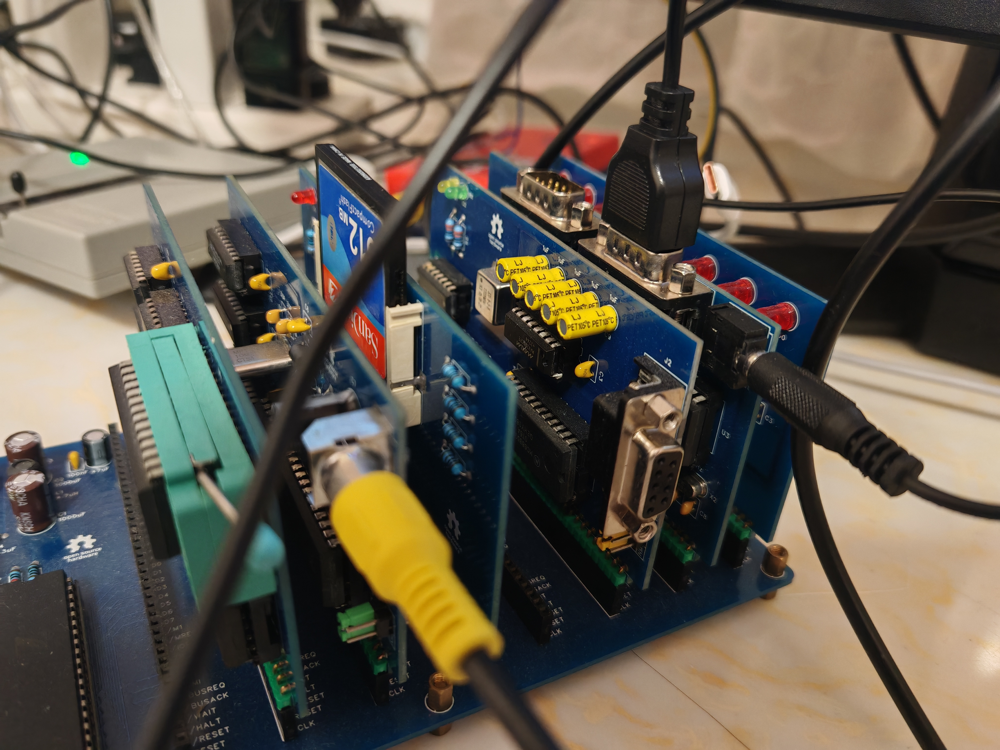
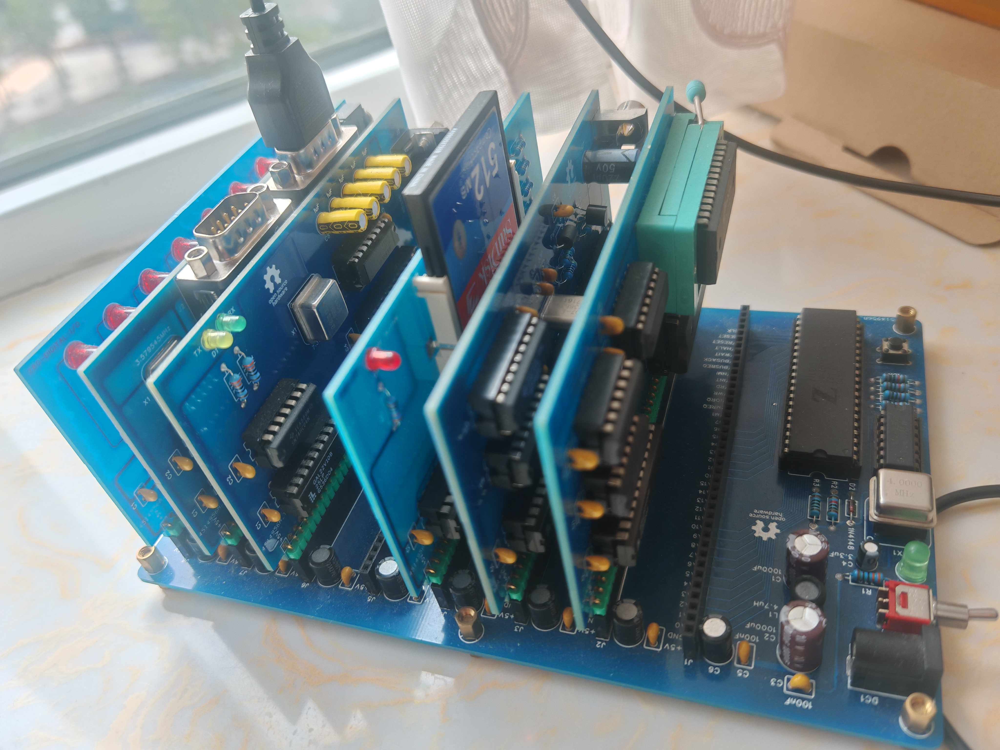
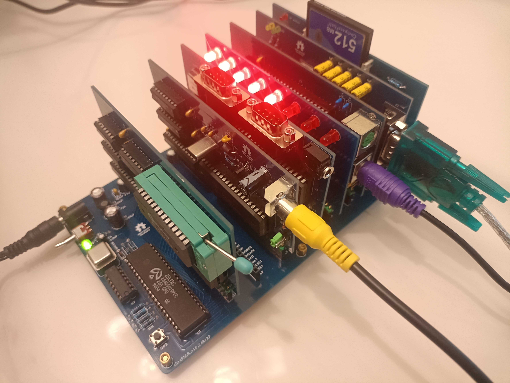
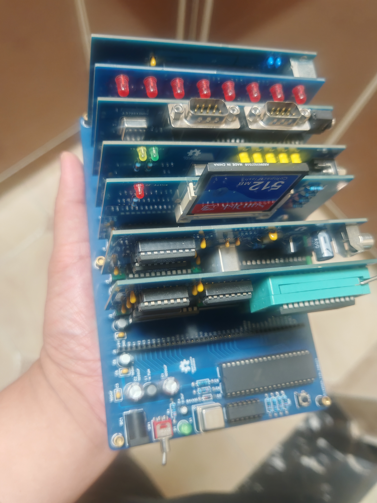

GAL22V10 Firmware:
1. Run z80v2.bat to set the environment for toolchain.
2. Navigate to <src\gal22v10> then run "make" command.
3. Burn the build\gal22v10\*.jed to GAL22V10.

Benchmark Test:
1. Run z80v2.bat to set the environment for toolchain.
2. Navigate to <src\benchmark> then run "make" command.
3. Burn the build\benchmark\*.bin to W27C512.

Homebrew Programs:
1. Run z80v2.bat to set the environment for toolchain.
2. Navigate to <src\homebrew> then run "make" command.
3. Burn the build\homebrew\*.bin to W27C512.

CP/M OS:
1. Run z80v2.bat to set the environment for toolchain.
2. Navigate to <src\cpm> then run "make" command.
3. Burn the build\cpm\loader.bin to W27C512.
4. Burn the build\cpm\cpm-8mb-hd.dsk to CF card.

Author: Bitrowz
Date: 2024/05/01

Follow me:  
[bilibili] https://space.bilibili.com/252130017  
[oshw]     https://oshwhub.com/ayssn  
[youtube]  https://www.youtube.com/@bit-m2p  

Screenshot:

